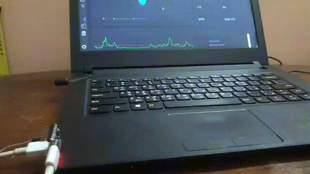
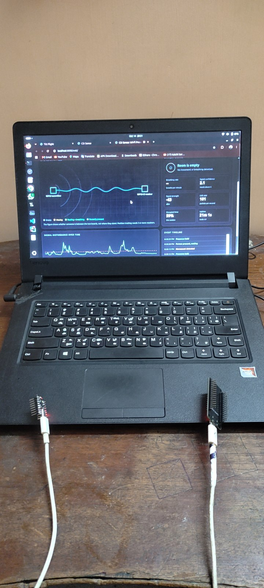
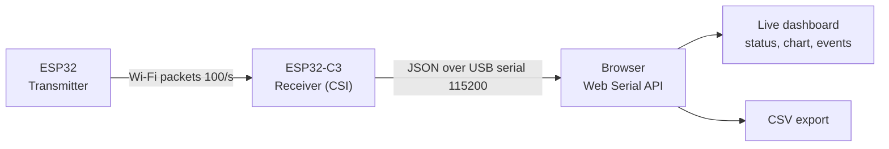
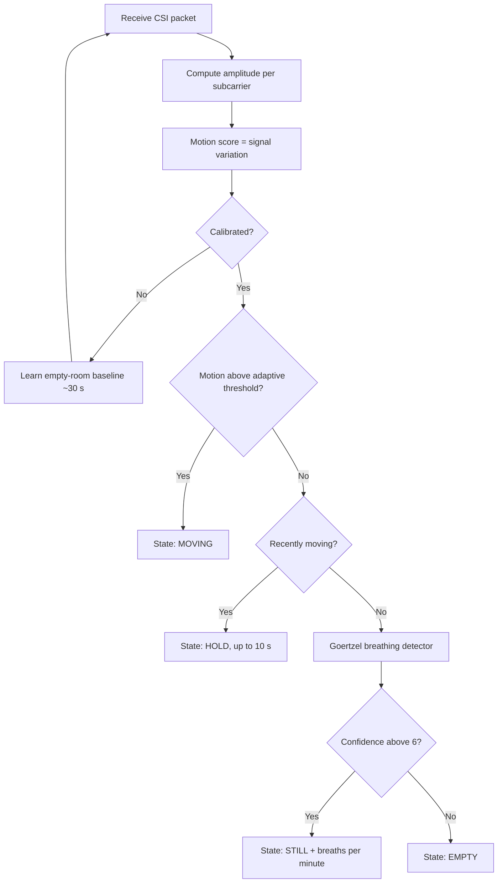
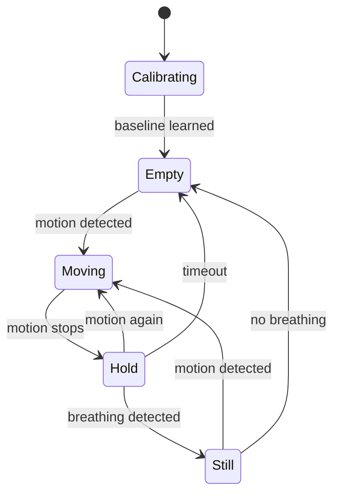

# CSI SENSE: Wi-Fi Presence & Breathing Monitor

Detects people and breathing using only Wi-Fi signals. No camera, no wearable.



▶ [Watch the full demo video](docs/media/demo.mp4)



## How it works

An ESP32 transmits about 100 packets per second. An ESP32-C3 measures the Channel State Information (CSI) of each packet. A body in the path disturbs the signal: walking causes large changes, breathing causes slow, small ones.

## System architecture



## Signal processing pipeline



## State machine



## Data format

The receiver prints one JSON line per second:

| Field | Meaning |
|---|---|
| `node` | Receiver ID |
| `t` | Uptime (ms) |
| `pps` | Packets per second (healthy is about 100) |
| `rssi` | Signal strength (dBm) |
| `motion` / `thr` | Disturbance score / learned threshold |
| `present` | 1 if someone is detected |
| `state` | calibrating, empty, moving, hold, still |
| `bpm` / `q` | Breaths per minute / rhythm confidence |

## Hardware

- ESP32 (transmitter)
- ESP32-C3 (receiver)
- 2 USB cables
- 1 laptop with Chrome or Edge

## Quick start

```bash
git clone https://github.com/solo-prince/CSI-SENSE.git
cd CSI-SENSE
python3 -m http.server 8000
```

Open http://localhost:8000/web/ in Chrome, then click **Connect sensor** (or **Demo mode**).

## Usage

1. Flash the transmitter and receiver firmware (ESP-IDF).
2. Place the boards 2-3 m apart.
3. Stay out of the sensing area for 30 s while it calibrates.
4. Walk between the boards, then sit still for about 20 s to see the breathing rate.

## Limitations

One link only. Accuracy drops with several people or strong Wi-Fi interference. Position tracking needs 3 or more receivers. Not a medical device.

## Author

Pravin, B.Sc Electronics and Artificial Intelligence
